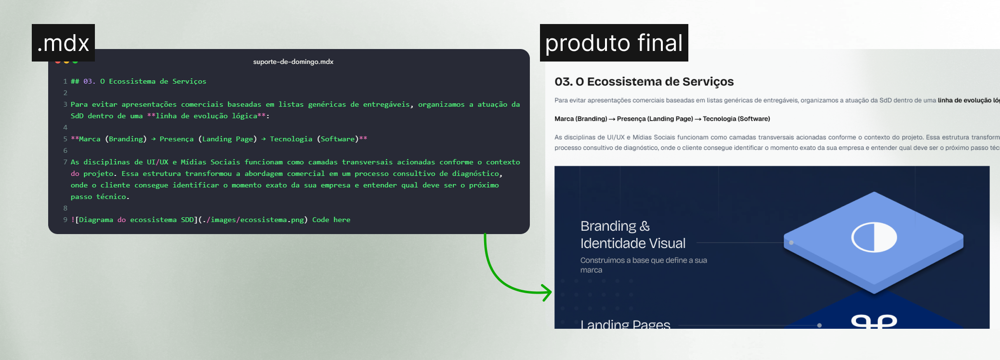
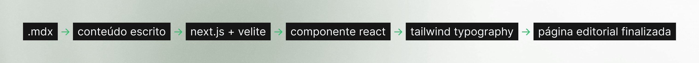

Construindo meu portfólio evergreen, decidi separar conteúdo de interface: o conteúdo deveria ser um documento, a interface só precisa apresentá-lo. Foi essa decisão que me levou ao MDX, uma escolha que mudou profundamente a forma como enxergo e estruturo o site inteiro.

## 01. Por que não Markdown puro, e por que não um CMS

Antes de chegar ao MDX, considerei duas alternativas bem óbvias:

- **Markdown puro:** resolveria a parte de "conteúdo como documento", mas me prenderia sempre que um projeto precisasse de algo visualmente específico, como uma galeria com comportamento próprio, um embed ou uma tabela comparativa com estilo diferente do resto do texto. Eu acabaria forçando tudo a caber em texto corrido ou criando exceções manuais para cada caso.
- **CMS headless:** resolveria a estrutura e a validação, mas introduziria uma dependência externa (serviço, conta, API) para um projeto que eu queria simples de rodar localmente, sem custo recorrente e sem pontos de falha fora do meu controle. Não fazia sentido para a escala do projeto.

O MDX resolve as duas pontas ao mesmo tempo: entrega a leveza do Markdown (documento versionado em texto simples, sem serviços externos) com a flexibilidade de embutir componentes React quando o conteúdo exige algo além do texto.



## 02. MDX como formato de conteúdo

Em vez de criar um componente específico para cada projeto, escrevo algo como:

```md
## Overview

The Thirteen é um arquivo visual criado...

A ideia surgiu da necessidade de...


## Design System

A interface utiliza...
```

A partir dessa estrutura, dois comportamentos acontecem automaticamente sem a necessidade de lógica adicional:

- **Índice dinâmico:** cada heading (`##` ou `###`) vira uma seção navegável no índice lateral (TOC) da página, extraído diretamente do texto.
- **Gestão de assets:** as imagens referenciadas com caminho relativo (`./images/interface.jpg`) são processadas, copiadas e otimizadas de forma automática, mantendo o contexto visual atrelado ao arquivo.

Quando o conteúdo pede algo que o Markdown não cobre por padrão, como uma galeria, um embed ou uma comparação lado a lado, insiro um componente React no meio do texto. O documento continua sendo a fonte de verdade; o componente só existe para apresentar melhor aquele trecho específico.

> MDX cuida do conteúdo. React cuida da experiência.

## 03. MDX + Next.js, via Velite

Cada projeto possui seu próprio `index.mdx` dentro do diretório, convivendo diretamente com os seus assets:

```text
content/
  projects/
    the-thirteen/
      index.mdx
      cover.jpg
      interface.jpg

    suporte-de-domingo/
      index.mdx
      cover.jpg

```

Isso resolve um gargalo recorrente de portfólios anteriores: as imagens deixam de ficar espalhadas em uma pasta global de assets sem relação clara com o projeto. Cada projeto passa a ser autocontido. Se eu abrir a pasta de um case daqui a dois anos, encontro exatamente tudo o que preciso para entender aquele projeto, sem rastrear arquivos em múltiplos lugares.

Quem faz a ponte entre os arquivos `.mdx` e o código React é o Velite. Ele lê a pasta `content/`, valida os arquivos contra um schema predefinido (título obrigatório, categoria, data, etc.), processa as imagens declaradas e gera tipagens em TypeScript automaticamente. Na prática, se eu esquecer de preencher um campo obrigatório em um projeto novo, o terminal aponta a falha durante o desenvolvimento, evitando quebras em produção.

## 04. Tailwind Typography para estilizar sem CSS por artigo

Para garantir uma estética editorial sem escrever CSS específico a cada texto, adotei o `@tailwindcss/typography`. Aplicando a classe `prose` no container do MDX, garanto uma base tipográfica consistente para títulos, parágrafos, listas, blockquotes, links, blocos de código e imagens:

```tsx
<article className="prose prose-neutral max-w-none">{children}</article>
```

Para ajustar o estilo padrão ao sistema visual do portfólio, personalizo a camada utilizando os modificadores utilitários do próprio plugin:

```tsx
<article
  className="
    prose
    prose-neutral
    max-w-none
    prose-headings:font-semibold
    prose-p:leading-relaxed
    prose-a:no-underline
  "
>
  {children}
</article>
```

Dessa forma, mantenho a semântica do Markdown perfeitamente alinhada ao design system. Ajustar o peso de um título ou o espaçamento de um parágrafo é algo feito direto no componente envoltório, sem a necessidade de tocar em arquivos de estilo separados.

## 05. O resultado

Um projeto pode crescer, um artigo pode ser atualizado e novos formatos de conteúdo podem surgir sem que a interface precise ser reconstruída. A camada visual se mantém agnóstica aos detalhes específicos dos projetos, focando apenas em apresentar a estrutura genérica compartilhada por cada `.mdx`.

No fim, a adoção do MDX foi menos uma escolha técnica isolada e mais a definição de uma arquitetura sustentável para o portfólio: o conteúdo evolui livremente enquanto o sistema de apresentação permanece estável.


